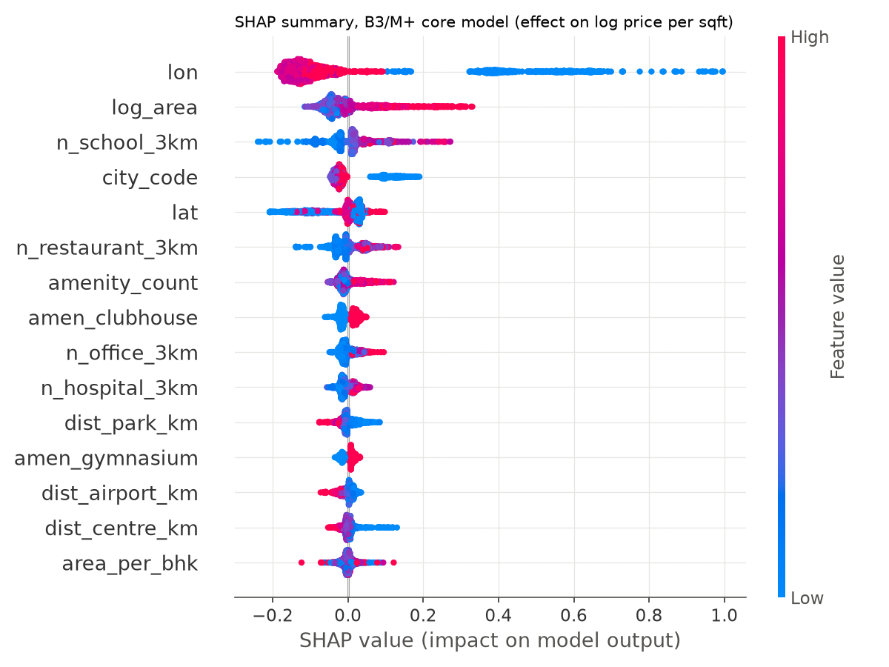
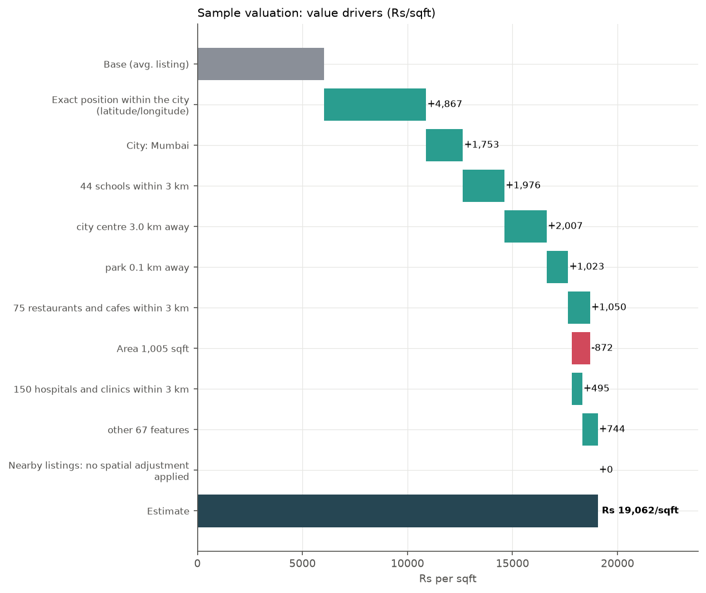
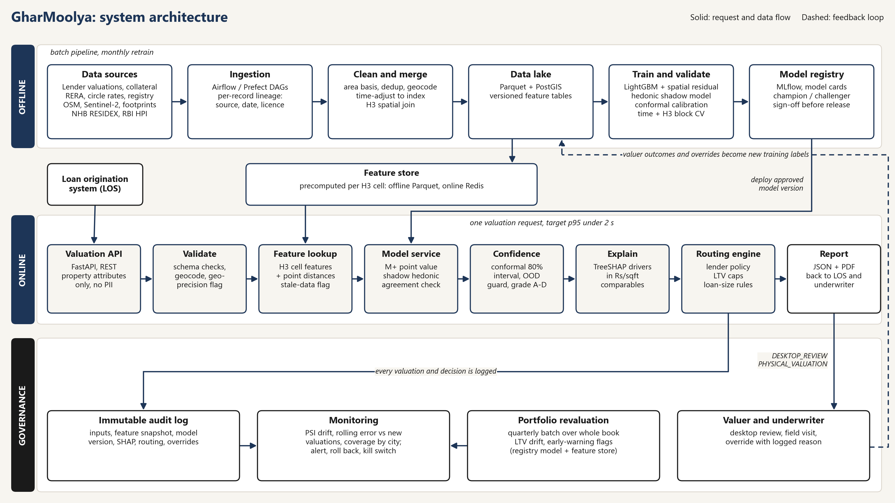
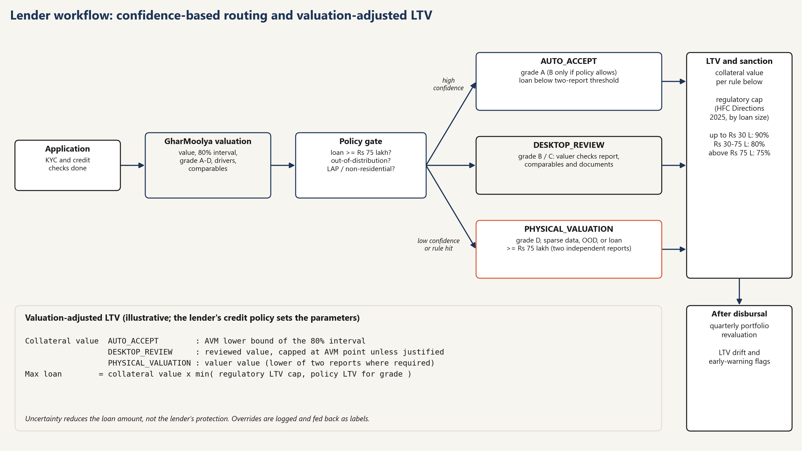
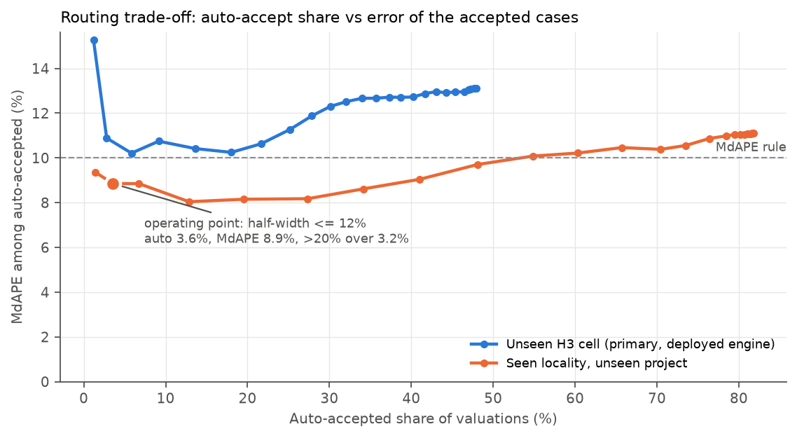
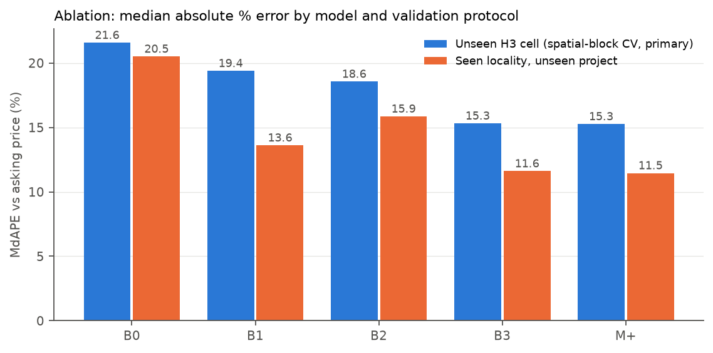
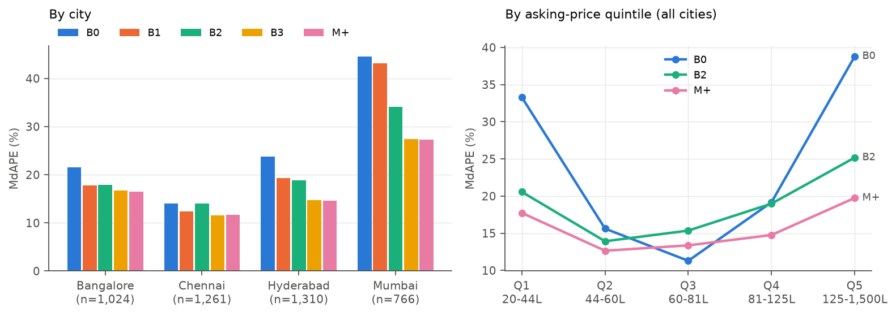
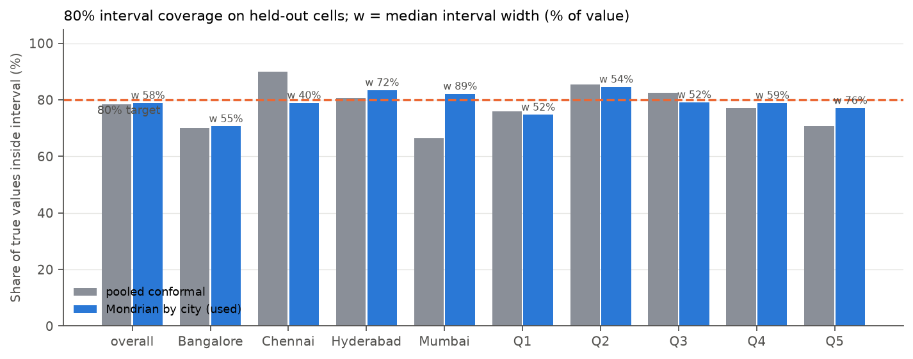
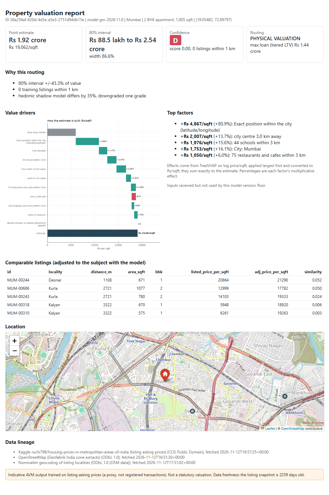

# GharMoolya: an explainable property valuation engine for Indian home loans

**Hero Housing Fintech Challenge, Problem Statement 1: AI-powered digital property valuation engine**
Team: Neural Knights (Shashank, Yatin Allan S, Nimit Jain)
Code: [github.com/shashankbindal/ihack](https://github.com/shashankbindal/ihack) · Live prototype: [ihack.shashankbindal.me](https://ihack.shashankbindal.me)

> All prototype numbers in this document come from `prototype/results/metrics.json` (generated by `prototype/run_all.py`). Errors are measured against **listing asking prices** from a 2020 open dataset, not against registered sale values or valuer reports.

---

## 1. Executive summary

Every home loan and LAP file at an HFC needs a collateral value. Today that value comes from a physical visit by an empanelled valuer. The visit costs money, adds days to sanction, and two valuers looking at the same flat often disagree.

GharMoolya is a valuation engine that a lender calls from its loan origination system (LOS). Given a location and a few property attributes, it returns:

- a point estimate in Rs and Rs/sqft;
- an 80% value range whose coverage is measured, not assumed;
- a confidence grade from A to D;
- the main factors behind the value, in Rs/sqft;
- nearby comparable listings;
- a routing recommendation: `AUTO_ACCEPT`, `DESKTOP_REVIEW` or `PHYSICAL_VALUATION`.

The core is a gradient-boosted tree model (LightGBM [R26]) on property attributes, location and accessibility features from OpenStreetMap. Conformalised quantile regression [R27][R8], calibrated separately per city [R10], gives the range. TreeSHAP [R25] explains each value. The production design adds satellite, RERA, circle-rate and price-index data; the prototype does not yet use them.

The engine does not replace valuers. RBI's Housing Finance Companies Directions, 2025 require a Board-approved valuation policy, empanelled independent valuers, and two independent valuation reports for loans of Rs 75 lakh and above [R14]. GharMoolya works inside that framework. It screens every file at login and gives desktop reviewers a structured second opinion. It also revalues the whole book each quarter. Only where the lender's Board policy allows, it sends high-confidence cases below the two-report threshold to a reduced-touch route.

**What the prototype shows.** We trained on 4,361 apartment listings in Mumbai, Bengaluru, Hyderabad and Chennai (cleaned from 21,458 raw rows) and tested on micro-markets the model had never seen (whole H3 cells held out). The main model's median absolute percentage error (MdAPE) is 15.3%. The comparable figures are 19.4% for a hedonic regression and 21.6% for a city-median baseline. Against a gradient-boosted model on listing attributes alone, the improvement is 3.30 points, a 17.8% relative cut (95% CI -5.01 to -1.63 points). That gain comes from location and OSM accessibility features. The extra spatial smoothing layer added nothing measurable. The 80% ranges covered 78.9% of held-out values, but they are wide (median 58% of value) and Bengaluru under-covers at 70.6%.

These results do not yet support auto-acceptance in unseen micro-markets. Under our rule (MdAPE at most 10% and at most 5% of cases over-valued by more than 20%), no threshold qualifies there. In localities the model has seen, 3.6% of cases could be auto-accepted at 8.9% MdAPE. On this public data the engine is a triage and desktop-review tool. Hero Housing's own valuation history is what would make it more than that, and Section 10 sets out how to test it on that data.

## 2. Problem and objective

**The lender's problem.** Collateral value drives the loan amount (through LTV caps), the risk grade, and later the provisioning view on the book. Physical valuation has three costs: the fee, the days added to turnaround, and inconsistency between valuers. AVMs are routine where transaction records are dense. In the US, Zillow reports a median error of roughly 2% for homes listed for sale and about 7% for homes not on the market [R12]. India lacks an open national transaction database, and listings rarely say whether area is carpet, built-up or super built-up. Prices also vary sharply within a few hundred metres, so a US-style AVM cannot be copied over.

**What PS1 asks.** An engine that estimates fair market value across India, more accurately than existing AVMs, explainably and at scale, and that reduces physical valuations while supporting risk-based lending.

**Our objective, stated so it can be tested.**

1. Beat our own baselines on unseen micro-markets, with a paired statistical test.
2. Produce value ranges whose stated coverage holds city by city.
3. Explain every valuation in terms an underwriter and an auditor can check.
4. Route each case to the cheapest safe path under the lender's policy and RBI rules.
5. Specify a pre-registered test against Hero Housing's incumbent process on its own data, since we cannot claim superiority over a commercial AVM we have not measured.

## 3. Scope the market

**Product definition.** Residential collateral valuation for home loans and LAP, delivered as an API with a one-page report. The engine values the property, not the borrower; it takes no personal data.

**Phased rollout.**

| Phase | Geography | Property types | Rationale |
|---|---|---|---|
| 0 (prototype, built) | Mumbai (MMR), Bengaluru, Hyderabad, Chennai | Apartments, resale and new | An open CC0 listing dataset covers these cities |
| 1 | Top 8 metros | Apartments, then independent houses and builder floors | Highest data density, best accuracy |
| 2 | Tier-2 and tier-3 cities in Hero Housing's lending footprint | Plotted land, independent houses | Circle-rate anchored, sparse-data model with wider ranges |
| 3 | Pan-India | Commercial and mixed-use LAP collateral | Income approach (rent x capitalisation rate); separate model |

**Extending to the rest of India.** Three mechanisms let the engine grow without pretending to know what it does not:

- *Hierarchical modelling.* A national model with city and micro-market effects. Micro-market estimates shrink toward the city, and the city toward the national level, so a new city starts from the national model plus local geo features. Recent work on five Indian cities found city-specific models beat a pooled one [R30]. Our own calibration results point the same way (Section 9): one pooled calibration covered only 66.3% in Mumbai, against 82.1% when calibrated per city.
- *Confidence-driven rollout.* Where data are thin, ranges widen and the grade drops, so cases route to a valuer automatically. The prototype already behaves this way: on unseen micro-markets 83.7% of cases graded D. Automation grows city by city as the engine earns it.
- *Anchors for thin markets.* State circle rates as a floor reference, NHB RESIDEX [R17] and RBI house price indices [R18] for time trends, and the lender's own historic valuation reports as labels.

**Who uses it.** Credit underwriters (value, range, routing), risk and compliance (audit trail, monitoring), operations (fewer valuer assignments) and, indirectly, the customer (faster in-principle approval).

**Out of scope.** Title and legal checks, statutory valuations required by regulation, and valuation of properties with known title defects.

## 4. Combine data sources

India has no open national transaction dataset, so we separate what a lender can use in production from what we could use legally for the prototype. The offline row of the architecture diagram (Section 7) shows the pipeline.

**Data catalogue.**

| # | Source | Type | Role | Production access | Used in prototype |
|---|---|---|---|---|---|
| D1 | Lender's historic valuation reports and disbursed-loan collateral | Structured | Ground truth for training | Internal | No (not available to us) |
| D2 | NHB RESIDEX (50 cities, from bank and HFC valuation prices) [R17]; RBI HPI (18 cities, registration data) and RPPI (bank/HFC loan data) [R18] | Aggregated indices | Time adjustment, city drift check | Public | No (the listing data carry no dates) |
| D3 | State registration records and circle (ready-reckoner) rates | Structured | Transaction signal where digitised; floor anchor | State portals, uneven | No |
| D4 | RERA project registries | Structured | Project status, builder track record, possession date | State RERA portals | No |
| D5 | Listings (asking price, area, BHK, resale flag, amenities) | Structured | Main price signal in the prototype | Licensed feeds or partnerships | Yes: Kaggle "Housing Prices in Metropolitan Areas of India", CC0, snapshot 2020-09-05 [R21] |
| D6 | OpenStreetMap | Geospatial | Distance to metro, rail, roads, offices, schools, hospitals; POI counts | Open (ODbL) | Yes: Geofabrik India zone extracts |
| D6b | Nominatim geocoder | Geospatial | Locality name to coordinates | OSM data, ODbL | Yes, at 1 request/s, cached |
| D7 | Sentinel-2 imagery | Unstructured | Built-up density, greenery, water [R5][R6] | Open (Copernicus) | No |
| D8 | Google Open Buildings v3 | Geospatial | Building footprint density | CC BY 4.0 or ODbL [R23] | No |
| D9 | Infrastructure pipeline (metro, expressway, airport) | Text and government releases | Forward-looking access features | Curated | No |
| D10 | Macro series (repo rate, rents) | Structured | Drift control | RBI DBIE | No |
| D11 | Street-level imagery | Unstructured | Condition proxy [R5] | Mapillary or licensed | No |
| D12 | Property documents (sale deed, approved plan, OC) | Unstructured | Attribute verification by OCR | Borrower upload via LOS | No |

We did not scrape 99acres, MagicBricks or Housing.com. We also rejected two open sources. The PyPI `india-housing-datasets` package says its data are synthetic. A second Kaggle set had a GPL-2 tag, unclear provenance and swapped coordinates. Licences are recorded in `prototype/data/LICENCES.md`. In production, portal data would come through licensed feeds.

**Collection.** In production, batch connectors (Airflow or Prefect) pull OSM extracts, imagery tiles, index releases, registry and RERA data. The lender's own records arrive over a secure API or SFTP with personal data removed before they reach the training zone. Every record carries `source`, `fetched_at`, `licence` and a quality flag. The prototype runs the same steps as one script (`run_all.py`) and records the source and fetch time of each input.

**Cleaning in the prototype.** Row counts from 21,458 raw listings to 4,361 modelled:

| Step | Rows left |
|---|---|
| Raw | 21,458 |
| Validity bounds (area 200-10,000 sqft, 1-6 BHK, 150-3,000 sqft per bedroom) | 21,451 |
| Listings that state at least one amenity | 8,014 |
| Deduplicated | 5,847 |
| City-wise outliers on log price/sqft removed (robust z above 3.5) | 5,706 |
| Locality geocoded to locality precision | 4,361 |

The largest cut is deliberate. A block of listings marks every amenity as "not mentioned". Their price/sqft spread around the locality median is three to four times that of complete listings in every city. In Mumbai, for example, the log spread is 0.80 against 0.23. That points to unreliable price or location fields, so we drop them.

**Designed but not applied in the prototype.**

- *Area basis.* Indian listings mix carpet, built-up and super built-up area. The production design learns a per-city loading factor from records that report both. The open dataset never states the basis, so area is used as listed and flagged.
- *Asking versus transaction price.* Asking prices exceed sale prices. A constant city discount would scale truth and estimate alike and leave percentage errors unchanged. With no paired data to learn anything better, we report against asking price.
- *Time indexing.* The data carry no listing dates, so no deflation to a reference quarter was possible.

**Merging.** Listings carry a locality name, not an address. Each one takes its locality's Nominatim centroid, and rows that resolve only to a city centroid are dropped. OSM distances and 0.5, 1 and 3 km counts are computed from that point. H3 cells provide the spatial keys for cross-validation and the residual layer. The production design precomputes neighbourhood and imagery features per H3 cell, so nothing heavy runs at request time.

**Leakage controls.** Deduplication runs before any split. Tests check three things: no listing or H3 cell appears in more than one of train, calibration and test; features never read price; and features are unchanged when prices are shuffled. A random split leaked new-project price lists during development, so the secondary protocol groups by project (Section 5).

## 5. Build the AI/ML model

**Target.** `log(price per sqft)`; value = `exp(prediction) x area`. A log target makes errors relative, which is how lenders read them.

**Features.**

| Group | Production design | Prototype |
|---|---|---|
| Property | type, BHK, area, floor, age, furnishing, parking, resale, amenities | BHK, area, resale flag, amenity flags (no floor or age in the data) |
| Location | city, H3 micro-market, pin code | city, latitude and longitude of the locality |
| Accessibility (OSM) | distance to metro, rail, highway, airport, CBD or IT cluster; POI counts | yes |
| Neighbourhood | built-up ratio, greenery, building density, satellite embedding | not built |
| Project (RERA) | builder track record, project size, possession date | not built |
| Market and time | city index, months since reference date, repo rate | not built |
| Anchors | zone circle rate | not built |

**Model stack.** We build up from simple to complex so each layer must earn its place:

| Layer | Model | Purpose | Prototype |
|---|---|---|---|
| B0 | City median Rs/sqft x area | Naive baseline | Built |
| B1 | Hedonic log-linear ridge with city and locality effects | The appraiser's classic; interpretable | Built |
| B2 | LightGBM on listing attributes and city | Tabular baseline | Built |
| B3 | LightGBM on attributes, location and OSM features | Value of location data | Built |
| M | B3 plus satellite features | Value of imagery | Not run (no imagery ingested) |
| M+ | B3 plus a spatial residual layer (distance-weighted mean of nearby out-of-fold residuals, weight fit on the calibration split) | Micro-market correction | Built, without imagery |
| Q | Conformalised quantile regression on M+, Mondrian by city | Calibrated range | Built |
| C | Comparable listings, model-adjusted | Sanity check underwriters understand | Built |

Gradient-boosted trees are the right core for tabular property data. They are accurate in published AVM studies [R1][R2], fast to serve, and exactly explainable with TreeSHAP [R25]. Indian studies point the same way, although their samples are small: non-linear models beat hedonic regression in Pune [R29] and across five cities [R30]. In the prototype, LightGBM runs with fixed settings; hyperparameter search with spatial-block CV is planned.

**How we measure accuracy.** We report the following on held-out data:

- median and mean absolute percentage error (MdAPE, MAPE);
- the share of values within 10% and 20% of the truth (PPE10, PPE20);
- median signed error (bias), where positive means over-valuation;
- the over-valuation tail, the share of values more than 20% above the truth;
- interval coverage and width;
- IAAO ratio-study statistics. The IAAO 2013 standard gives reference ranges of COD 5 to 10 for homogeneous residential areas, 5 to 15 for older or mixed areas, and PRD 0.98 to 1.03 for vertical equity [R13]. Those ranges were written for property-tax assessment, so we use them as a reference, not a pass mark.

**Validation protocol.**

1. Deduplicate first.
2. *Primary: spatial blocks.* Five-fold cross-validation grouped by H3 resolution-7 cell, so every test listing sits in a cell the model never saw. This is the honest estimate for a property in a new micro-market. Each fold trains on about 2,818 listings and keeps about 671 for calibration (20% of training cells). Every one of the 4,361 listings is scored once, out of fold.
3. *Secondary: seen locality, unseen project.* Five folds grouped by a project proxy (city, locality, amenity signature). 88.2% of test localities appear in training, but the project itself does not. This is closer to a lender's established markets.
4. *No time split.* The data carry no dates. In production, a rolling train-on-past, test-on-future backtest is mandatory.
5. Ablation from B0 to M+.
6. *Significance.* A paired bootstrap of the MdAPE difference that resamples whole H3 cells (314 clusters, 2,000 draws). A model "wins" only if the 95% interval excludes zero.
7. *Subgroup audit* by city, price band, BHK and resale status, reporting the worst subgroup alongside the average.

**On "significantly higher accuracy than existing AVMs".** We can show a measured gain over our own baselines under the same split (Section 9). We cannot show a gain over Hero Housing's incumbent process or any vendor AVM without running both on the same properties. So we pre-register the test (Section 10). On at least 1,000 recent properties with a trusted value, GharMoolya must cut MdAPE by at least 15% relative to the incumbent, with a bootstrap interval excluding zero, and its over-valuation tail must be no worse. The 15% bar is our proposal; the lender may set its own. On public data our model clears that bar against our own attribute-only GBM baseline (17.8%), which tells us the margin is achievable. It says nothing yet about the incumbent.

**Why we expect gains in India.** Price dispersion inside an Indian city is driven by metro access, project quality, builder track record, plot density and pending infrastructure, and generic AVMs built on assessor records miss most of these. The prototype already shows that location and OSM accessibility alone account for the whole gain from B2 to B3. Project, imagery and index features are the next layers to test.

**Sparse markets.** Hierarchical shrinkage, an out-of-distribution guard, and abstention: when comparables are few or the range is too wide, the engine routes to a valuer instead of offering a confident number. Valuer outcomes on referred cases flow back as labels.

## 6. Make it explainable

Each valuation returns one JSON record, rendered as a one-page report:

```json
{
  "valuation_id": "uuid",
  "model_version": "gm-2026.11.0",
  "value": {"point_inr": 0, "per_sqft_inr": 0, "low_inr": 0, "high_inr": 0, "interval_level": 0.8},
  "confidence": {"grade": "B", "interval_width_pct": 0, "n_comparables": 0, "data_freshness_days": 0},
  "top_factors": [{"feature": "dist_metro_km", "effect_inr_per_sqft": 0, "plain_text": "Within 600 m of a metro station"}],
  "comparables": [{"id": "...", "distance_m": 0, "adj_price_per_sqft": 0}],
  "routing": "DESKTOP_REVIEW",
  "routing_reasons": ["interval wider than 12%", "3 comparables within 1 km"],
  "inputs_not_used": ["floor", "age"],
  "data_lineage": [{"source": "OSM", "fetched_at": "..."}],
  "disclaimer": "Indicative AVM output. Not a statutory valuation."
}
```

**Why this value.** TreeSHAP [R25] splits each prediction into feature contributions in log price. We apply them largest first and convert each step to Rs/sqft, so the steps add up exactly to the estimate. The split between factors depends on that order, and the report says so. The underwriter sees lines such as "+Rs 850/sqft: 450 m from a metro station". A SHAP summary across all listings shows what the model relies on overall. Shapley-based explanation of AVMs is established in the literature [R1][R2].





**What sold nearby.** The comparables module lists the closest similar listings, adjusted by the model for differences in area and attributes. Underwriters already reason this way, so it is the fastest route to trust. In the prototype, coordinates are locality centroids, so "nearby" means the same or an adjacent locality.

**A second opinion.** The hedonic model runs on every request as a shadow, in the spirit of locally interpretable boosting [R3]. A case is eligible for auto-accept only if the shadow lands within 20% of M+ and the request is in distribution.

**How confident.** Plain quantile regression tends to undercover; conformalised quantile regression gives a coverage guarantee on held-out data [R27][R8]. A single global calibration can be right on average and wrong in a given city, so we add a separate conformal margin per city (Mondrian) [R10] and check coverage locally [R9]. The grade combines interval half-width, comparable count, the shadow-model gap and out-of-distribution checks:

| Grade | Rule in the prototype (80% interval half-width) | Default route |
|---|---|---|
| A | at most 8%, plus eligibility checks | `AUTO_ACCEPT` if policy allows |
| B | at most 12% | `AUTO_ACCEPT` in the prototype default; we recommend `DESKTOP_REVIEW` until pilot data justify more (Section 9) |
| C | at most 20% | `DESKTOP_REVIEW` |
| D | wider, or out of distribution | `PHYSICAL_VALUATION` |

**Audit.** An immutable log stores, per valuation, the inputs, feature snapshot, model version, SHAP values, output, route and any human override. Code, data versions and seeds are pinned, so an auditor can re-run any past valuation and get the same answer. Each release ships with a model card covering intended use, limits, subgroup performance and known failure modes. In the prototype, the response contract, reproducible build and tests exist; the immutable log store is designed, not built.

**Fairness.** We report error and bias by price band and other subgroups, so that the engine does not systematically mis-value cheaper or costlier homes. The prototype found exactly this pattern (Section 9): the lowest price band is over-valued and the highest under-valued. This follows the FREE-AI committee's principles of Fairness and Equity and Understandable by Design [R16].

## 7. Automate and scale



**Request path.** LOS calls the valuation API with property attributes only. The service then:

1. validates and geocodes the request;
2. looks up features for the location;
3. runs M+ and the shadow model;
4. applies the conformal layer and the out-of-distribution guard;
5. computes TreeSHAP and comparables;
6. applies routing rules, including the Rs 75 lakh gate and the LTV caps;
7. returns JSON plus the report.

Our design target was under 2 seconds at the 95th percentile. The prototype API measured a p95 of 119 ms and a p50 of 96 ms over 200 sequential requests, including SHAP and comparables. That was a single uvicorn worker on a 13th-gen Intel Core i5 laptop.

**Components.**

| Layer | Choice | Note |
|---|---|---|
| Ingestion | Airflow or Prefect | One DAG per source, per city |
| Storage | Object store with Parquet; PostGIS | Versioned datasets |
| Feature store | H3-keyed Parquet offline; Redis online | No imagery processing at request time |
| Training | LightGBM, scikit-learn, MLflow | Monthly retrain, spatial CV |
| Serving | FastAPI container, autoscaled on Kubernetes | Stateless pods |
| Batch | Spark or Dask | Quarterly revaluation of the whole book |
| Monitoring | PSI drift, rolling error against new valuer reports, coverage by city | Alerts and roll back to the previous champion |
| Governance | Model registry, approvals, model cards, audit log | Section 8 |

**Minimal manual work.** Geocoding, feature assembly, valuation, explanation and routing are automatic. People are involved only on `DESKTOP_REVIEW` and `PHYSICAL_VALUATION`, and their outcomes become labels. On public data that is most cases (Section 9). The referred share should fall as the engine trains on the lender's own valuations.

**Scaling across India.** A new city is a configuration pack (OSM extract, imagery tiles, index mapping, circle-rate table, calibration set) run through the existing pipeline, not new code. The prototype added four cities this way from two Geofabrik zone extracts. The hierarchical model and per-city calibration mean a new city starts with wide ranges and conservative routing. It earns automation as its own data come in. The API is stateless and scales horizontally, and the feature cache can be sharded by state or H3 prefix.

**Cost.** Open data and a compact tree model keep the marginal cost per valuation low. We do not quote a saving figure. The economics calculator in the prototype UI takes Hero Housing's actual valuation fee and turnaround as inputs; the only measured input is the auto-accept share from the trade-off curve.

**Resilience.** If a data feed is stale, the affected features are flagged and the grade drops. If monitoring breaches a threshold, a kill switch sends every case to physical valuation until the issue is cleared.

**Security and privacy.** We use encryption in transit and at rest and role-based access. No borrower personal data enters the valuation service. Borrower data stay in the LOS under the DPDP Act 2023 and the DPDP Rules 2025, whose main obligations apply from about May 2027 [R19]. We recommend hosting in an Indian cloud region. We found no general RBI localisation rule for HFC lending data, but in-country hosting simplifies DPDP and outsourcing reviews.

**Built versus designed.**

- *Built:* the data pipeline for four cities, the B0 to M+ model stack, the conformal and explanation layers, and routing with the policy gate. There is also a FastAPI endpoint, a Streamlit UI with the trade-off curve and economics calculator, and tests for cleaning, leakage and the API contract.
- *Designed, not built:* orchestration, the online feature store, Kubernetes deployment, the immutable audit store, monitoring, and batch revaluation at book scale.

## 8. Enable lending decisions



**Where it sits.** Valuation runs at login, after KYC and bureau checks. The customer can get an indicative eligibility within minutes, and a physical valuation is ordered only when needed.

**How it reduces physical valuations.**

1. *Policy gate first.* Loans of Rs 75 lakh and above always get the two independent valuation reports required by the HFC Directions, with the lower value used [R14]. The prototype API enforces this. LAP on non-residential or mixed-use property, and out-of-distribution cases, also go to a valuer by default.
2. *Confidence routing for the rest.* High-grade cases go to `AUTO_ACCEPT`, which means no field visit, where the lender's policy allows it. Middle grades go to desktop review, where a valuer checks the report, comparables and documents remotely. Grade D goes to a field visit.
3. *Trade-off curve.* The prototype plots the share of cases auto-accepted against the error among them, and the lender chooses the operating point. On public data the results are:
   - *Unseen micro-markets:* no threshold met our rule (MdAPE at most 10% and no more than 5% of accepted cases over-valued by over 20%). With the prototype's default grades, 83.7% of cases went to a field visit and 15.1% to desktop review.
   - *Seen localities:* auto-accepting when the half-width is at most 12% covers 3.6% of cases, at 8.9% MdAPE, with 3.2% over-valued by more than 20%.
   - The near-term saving is therefore in turning field visits into desktop reviews, not in removing valuers. Trained on Hero Housing's own valuation data, the curve should move, and the pilot measures by how much.
4. *Early screening.* Where the engine's upper bound is far below what the requested loan needs, the file can be stopped or restructured before any valuer is assigned.



Whether `AUTO_ACCEPT` may skip a visit is a decision for Hero Housing's Board-approved valuation policy. RBI's Directions require that policy and empanelled valuers but say nothing about AVMs [R14]. We position GharMoolya as decision support and triage, and recommend legal and compliance sign-off before any waiver is switched on.

**Risk-based lending.**

- *Valuation-adjusted LTV.* For auto-accepted cases, LTV is applied to the **lower bound** of the 80% range, not the point estimate. Uncertainty therefore shrinks the loan rather than the lender's cushion, and a tighter range costs the borrower less.
- *Regulatory caps on top.* The HFC Directions cap LTV for individual housing loans at 90% up to Rs 30 lakh, 80% above Rs 30 lakh up to Rs 75 lakh, and 75% above Rs 75 lakh. The bands are set by loan amount, and stamp duty and registration charges are excluded from property cost [R14]. The prototype API returns the maximum loan under these tiers.
- *Pricing and limits.* Grade and range width can feed the credit scorecard, for example as a lower policy LTV or a wider spread for weaker grades.
- *Book monitoring.* A quarterly batch revaluation flags loans whose current LTV has drifted up, supporting early warning, provisioning views and collections. This applies to the whole existing book, not just new loans.

**Regulatory fit.**

| Area | Our position | Source |
|---|---|---|
| Valuation and valuers | A Board-approved valuation policy and empanelled independent valuers are required, with two reports at Rs 75 lakh and above. The engine supports these and never replaces the two reports. | [R14] |
| LTV | Caps applied as hard rules after valuation | [R14] |
| AI governance | Aligned with the FREE-AI recommendations on a board-approved AI policy (Rec 14), lifecycle governance and drift monitoring (Rec 16), an AI inventory (Rec 23), risk-based AI audit (Rec 24) and instant termination capability (para 4.4.58). FREE-AI is a committee report, not a binding Direction. | [R16] |
| Model risk | Model inventory, independent validation, champion-challenger, back-testing and documented limits. Designed to RBI's June 2026 draft model risk guidance, which covers AI/ML and third-party models. | [R22] |
| International reference | US interagency AVM quality-control rule: confidence in estimates, protection against data manipulation, no conflicts of interest, random sample testing and non-discrimination. It is not Indian law, but it is a useful checklist. | [R24] |
| Data protection | Property data only in the model; borrower data in LOS under DPDP | [R19] |
| Audit trail | Immutable per-valuation log including overrides | Section 6 |

**Human in the loop.** Any underwriter can override, with a logged reason that feeds back into training. Monitoring breaches trigger automatic fallback to physical valuation.

## 9. Prototype and results

**What we built.** A reproducible Python prototype covers Mumbai (MMR), Bengaluru, Hyderabad and Chennai apartments. One command (`python run_all.py`) runs everything end to end: it downloads the data, cleans and geocodes it, builds OSM features, trains B0 to M+, calibrates intervals, computes metrics and figures, benchmarks the API and runs the tests. The FastAPI endpoint (`POST /valuate`) and a Streamlit UI serve the trained engine. The UI covers the valuation report, the routing curve and the economics calculator.

**Data.** The data are the Kaggle "Housing Prices in Metropolitan Areas of India" set (CC0, snapshot 2020-09-05), plus OSM via Geofabrik (ODbL) and Nominatim geocoding. After cleaning, 4,361 listings remain from 21,458 raw: Bengaluru 1,024, Chennai 1,261, Hyderabad 1,310 and Mumbai 766. Ground truth is the **listing asking price**. These results show the method works on public proxy data. They are not a claim about accuracy against sale values or valuer reports.

**Ablation, primary protocol (unseen H3 cells), errors in % of asking price.**

| Model | MdAPE | PPE10 | PPE20 | Bias | Over-valued >20% | COD | PRD |
|---|---|---|---|---|---|---|---|
| B0 city median | 21.6 | 25.3 | 47.1 | -0.0 | 28.7 | 28.0 | 1.236 |
| B1 hedonic ridge | 19.4 | 28.6 | 51.2 | +3.3 | 28.6 | 25.6 | 1.169 |
| B2 GBM, attributes | 18.6 | 29.2 | 52.9 | +0.7 | 26.6 | 25.3 | 1.102 |
| B3 GBM, + location and OSM | 15.3 | 34.3 | 61.8 | +0.0 | 20.9 | 20.1 | 1.080 |
| M GBM, + imagery | not run | | | | | | |
| M+ B3 + spatial residual | 15.3 | 33.8 | 61.6 | +0.2 | 21.1 | 20.1 | 1.078 |



**Significance (paired cluster bootstrap over 314 H3 cells, 2,000 draws).**

| Comparison | MdAPE difference (points) | 95% CI | Relative cut |
|---|---|---|---|
| M+ vs B0 | -6.31 | [-9.10, -3.82] | 29.3% |
| M+ vs B1 | -4.12 | [-7.24, -1.31] | 21.3% |
| M+ vs B2 | -3.30 | [-5.01, -1.63] | 17.8% |
| M+ vs B3 | -0.05 | [-0.33, 0.27] | not significant |

The gain over B2 is real and comes from location and OSM accessibility features (B2 to B3). The spatial residual layer that turns B3 into M+ adds nothing measurable on unseen cells. Its calibrated weight stayed high in four of five folds, but the bootstrap cannot tell M+ from B3. We keep it because the cost is negligible, and we will drop it if lender data confirm it adds nothing.

**Secondary protocol (seen locality, unseen project).** M+ MdAPE is 11.5%, against 13.6% for the hedonic model and 15.9% for the attribute-only GBM. M+ vs B1 is -2.15 points (CI -3.32 to -1.00), a 15.8% cut. When the locality is known, the hedonic model with locality effects is a strong baseline: it beats the attribute-only GBM, and our model's margin over it is smaller than on unseen cells. That fits how Indian prices work. Locality explains a great deal, so the engine's value is largest where locality knowledge is thin.

**Per city (M+, unseen cells).**

| City | n | MdAPE | Bias | Over-valued >20% | 80% coverage | Median width | MdAPE, seen locality |
|---|---|---|---|---|---|---|---|
| Bengaluru | 1,024 | 16.5 | +6.6 | 31.8 | 70.6 | 55.0 | 13.0 |
| Chennai | 1,261 | 11.7 | +0.8 | 13.6 | 78.9 | 40.4 | 8.8 |
| Hyderabad | 1,310 | 14.6 | -0.4 | 21.8 | 83.4 | 71.9 | 12.5 |
| Mumbai | 766 | 27.2 | -16.2 | 17.6 | 82.1 | 89.3 | 12.7 |



Mumbai is the weak spot. On unseen cells its MdAPE is 27.2% and it is under-valued by a median 16.2%. Its ranges are very wide (median width 89%), which is the right response. When the locality is known, Mumbai's MdAPE falls to 12.7%. Mumbai prices change sharply over short distances, and locality-centroid coordinates cannot capture that. Bengaluru is the over-valuation risk: on unseen cells 31.8% of its values are more than 20% above asking, and its 80% ranges cover only 70.6%.

**By price band (M+, unseen cells).** The lowest fifth of listings (Rs 20 lakh to about Rs 43.6 lakh) is over-valued by a median 16.3%, with 42.0% of values more than 20% too high. The highest fifth is under-valued by 12.2%. This is regression toward the middle. PRD of 1.078, above the IAAO reference range of 0.98 to 1.03 [R13], says the same thing. Overall COD (20.1) is also above the IAAO residential reference ranges. For a lender, over-valuing the cheapest homes matters most, because these are the affordable-housing loans with the highest LTV caps. The production model must fix this before any auto-acceptance in that band. Options include price-band calibration, lender labels and a policy that never auto-accepts that band without review. Resale listings are harder than new ones (MdAPE 21.4% against 13.9%).

**Calibration.**

- Overall coverage: 78.9% against a nominal 80%, with median width 58.2% of value.
- Per city: Bengaluru 70.6%, Chennai 78.9%, Hyderabad 83.4%, Mumbai 82.1%.
- Per-city (Mondrian) calibration clearly helps. A single pooled calibration gave 66.3% in Mumbai and 90.0% in Chennai.
- Seen-locality coverage is 79.7% at a median width of 50.0%.
- The ranges are honest but too wide to support many decisions on this data.



**Routing.**

- *Grade mix on unseen cells:* A 0%, B 1.2%, C 15.1%, D 83.7%.
- *Auto-accepted grade B:* the prototype's default rule auto-accepts B. On unseen cells those cases had 15.3% MdAPE and 30.8% over-valued by more than 20%, which is not acceptable. We therefore recommend grade B goes to desktop review until lender data show otherwise.
- *Seen localities:* the mix is A 0.4%, B 3.2%, C 24.1%, D 72.4%. A 12% half-width threshold meets our acceptance rule there: 3.6% auto-accepted, MdAPE 8.9%, 3.2% over-valued by more than 20%.
- *Loan amounts:* the dataset has none, so the Rs 75 lakh gate is applied in the API and calculator, not in these offline routing figures.

**Explanation and report.** The sample report is for a Mumbai listing (MUM-00648) asking Rs 95 lakh. The engine valued it at about Rs 1.92 crore, graded it D and routed it to `PHYSICAL_VALUATION`. We show this case on purpose: the estimate is far off, and the confidence layer stopped it from being used.



**Latency.** p95 119 ms, p50 96 ms, maximum 152 ms over 200 sequential requests to a single local worker, including SHAP and comparables.

**Limits of the prototype.**

- The ground truth is asking prices from one 2020 snapshot, not transaction values or valuer reports.
- Coordinates are locality centroids, not addresses, so distance features and comparables work at locality resolution.
- Only four cities and apartments are covered, with 766 to 1,310 listings per city.
- The following were not run (from `not_run` in `metrics.json`):
  - *Imagery model (M):* Sentinel-2 and satellite embeddings were not ingested, so the imagery ablation does not exist.
  - *Time split:* the listings carry no dates, so there is no train-on-past backtest.
  - *Time index adjustment:* no RESIDEX or RBI index deflation was applied.
  - *Asking-to-transaction adjustment:* there are no paired data to learn a discount.
  - *Area normalisation:* the area basis is not stated in the data and is used as listed.
  - *RERA and circle-rate features:* not integrated.
  - *Floor and age features:* absent from the data. The API accepts them and reports them as unused.
  - *Hyperparameter search:* not run; fixed LightGBM settings are used.
  - *Head-to-head against a commercial or lender AVM:* no such outputs were available; only the protocol is specified.
  - *Rs 75 lakh gate in offline metrics:* the data have no loan amounts.
  - *OSM multipolygon relations:* some large parks and campuses are not read.

## 10. Risks, limitations and pilot plan

**Risks and mitigations.**

| Risk | Mitigation |
|---|---|
| Ground truth: asking prices overstate value and differ from valuer opinions | Train on the lender's valuation reports and registry data in production; report asking-price results separately; time-adjust with indices |
| Thin markets and new cities (prototype: 83.7% grade D on unseen cells) | Hierarchical shrinkage, wide ranges, abstention, per-city calibration; automation only after coverage holds locally |
| Over-valuation of cheaper homes (prototype: lowest price band +16.3% bias) | LTV on the lower bound; price-band calibration; no auto-accept in that band without review; over-valuation tail tracked as a headline metric |
| Under-coverage in some cities (prototype: Bengaluru 70.6%) | Per-city or per-cluster conformal margins on lender data; coverage checked before each release |
| Price shocks | Index-based time adjustment, monthly retrain, drift alarms, larger haircuts in volatile periods |
| Attribute gaming (inflated area, wrong floor) | Cross-check against sale deed and approved plan (OCR) and against footprints; flag inconsistencies |
| Regulatory change | Design to FREE-AI and the draft model risk guidance; keep the human route intact; re-check when the guidance is finalised |
| Over-reliance on the engine | Human override, kill switch, mandatory valuer route above Rs 75 lakh |

**Known limitations.** No open national transaction data exist, so accuracy on Hero Housing's portfolio is unknown until the shadow pilot. On public data the engine is accurate enough for triage and desktop-review support, not yet for waiving visits in unfamiliar micro-markets. Commercial property needs a separate income-approach model and is not covered by our results. Whether imagery adds value is untested.

**Pilot plan.**

| Phase | Duration | What happens | Exit criterion |
|---|---|---|---|
| 0. Data onboarding | 4 to 6 weeks | Load 3 to 5 years of Hero Housing valuation reports and collateral data for 2 metros; add exact coordinates, dates and area basis; retrain with a time split and recalibrate | Reproducible pipeline; data quality report signed off |
| 1. Shadow | 8 to 12 weeks | Engine runs on every new file in those metros; no decisions use it | Pre-registered bar met on at least 1,000 properties: MdAPE at least 15% lower than the incumbent (bootstrap interval excludes zero), over-valuation tail no worse, 80% coverage within agreed tolerance per city and price band |
| 2. Assist | 8 weeks | Desktop reviewers see the report; turnaround and agreement tracked | High agreement with reviewers; measured turnaround gain |
| 3. Limited auto | Ongoing, quarterly review | Grade A only, loans below Rs 75 lakh, high-density metros, under a Board-approved policy amendment | Override rate, realised loss and back-tested error stay within risk appetite |

Each phase has a named owner in credit risk, and any phase can be rolled back.

## 11. References

- [R1] Tchuente, D. (2024). Real Estate Automated Valuation Model with Explainable Artificial Intelligence Based on Shapley Values. *Journal of Real Estate Finance and Economics* 72(3), 567-605. https://doi.org/10.1007/s11146-024-09998-9
- [R2] Tarasov, S. and Dessoulavy-Śliwiński, B. (2025). Algorithm-Driven Hedonic Real Estate Pricing: An Explainable AI Approach. *Real Estate Management and Valuation* 33(1), 22-34. https://doi.org/10.2478/remav-2025-0003
- [R3] Hjort, A., Scheel, I., Sommervoll, D. E. and Pensar, J. (2024). Locally interpretable tree boosting: An application to house price prediction. *Decision Support Systems* 178, 114106. https://doi.org/10.1016/j.dss.2023.114106
- [R5] Law, S., Paige, B. and Russell, C. (2019). Take a Look Around: Using Street View and Satellite Images to Estimate House Prices. *ACM TIST* 10(5). https://doi.org/10.1145/3342240
- [R6] Bency, A. J. et al. (2017). Beyond Spatial Auto-Regressive Models: Predicting Housing Prices with Satellite Imagery. *IEEE WACV*, 320-329. https://doi.org/10.1109/WACV.2017.42
- [R8] Bastos, J. A. and Paquette, J. (2024). On the uncertainty of real estate price predictions. *Journal of Property Research* 42(1), 1-19. https://doi.org/10.1080/09599916.2024.2403998
- [R9] Hjort, A., Hermansen, G. H., Pensar, J. and Williams, J. P. (2025). Uncertainty quantification in automated valuation models with spatially weighted conformal prediction. *International Journal of Data Science and Analytics* 20(8), 7089-7106. https://doi.org/10.1007/s41060-025-00862-4
- [R10] Hjort, A., Williams, J. P. and Pensar, J. (2024). Clustered Conformal Prediction for the Housing Market. *PMLR* 230 (COPA 2024), 366-386. https://proceedings.mlr.press/v230/hjort24a.html
- [R12] Zillow. Zestimate accuracy. https://www.zillow.com/zestimate/ (figures as reported in October 2026, accessed via secondary sources)
- [R13] IAAO (2013). *Standard on Ratio Studies*; IAAO (2018). *Standard on Automated Valuation Models*. https://www.iaao.org/
- [R14] Reserve Bank of India (2025). *Reserve Bank of India (Housing Finance Companies) Directions, 2025*, RBI/DoR/2025-26/365, 28 November 2025, paras 58 and 215 and Annex V. https://www.rbi.org.in/Scripts/BS_ViewMasDirections.aspx?id=12939
- [R16] Reserve Bank of India (2025). *Report of the Committee on Framework for Responsible and Ethical Enablement of Artificial Intelligence (FREE-AI)*, 13 August 2025. https://rbi.org.in/Scripts/PublicationReportDetails.aspx?ID=1306
- [R17] National Housing Bank. NHB RESIDEX, quarterly releases. https://www.nhb.org.in/about-residex/
- [R18] Reserve Bank of India. House Price Index and Residential Property Price Index. https://www.rbi.org.in/scripts/BS_ViewBulletin.aspx?Id=15182
- [R19] Digital Personal Data Protection Act, 2023, and Digital Personal Data Protection Rules, 2025.
- [R21] Kaggle, "Housing Prices in Metropolitan Areas of India" (user ruchi798), CC0: Public Domain, snapshot 2020-09-05. https://www.kaggle.com/datasets/ruchi798/housing-prices-in-metropolitan-areas-of-india. OpenStreetMap contributors via Geofabrik (ODbL 1.0), https://download.geofabrik.de/asia/india.html; Nominatim, https://nominatim.openstreetmap.org. Details in `prototype/data/LICENCES.md`.
- [R22] Reserve Bank of India (2026). Draft *Guidance on Regulatory Principles for Model Risk Management*, press release 24 June 2026. https://www.rbi.org.in/scripts/BS_PressReleaseDisplay.aspx?prid=63006
- [R23] Google Research. Open Buildings v3. https://sites.research.google/open-buildings/
- [R24] CFPB et al. (2024). Quality Control Standards for Automated Valuation Models, 12 CFR 1026.42(i). https://www.consumerfinance.gov/compliance/compliance-resources/mortgage-resources/quality-control-standards-for-automated-valuation-models/
- [R25] Lundberg, S. M. and Lee, S.-I. (2017). A Unified Approach to Interpreting Model Predictions. *NeurIPS 30*, 4765-4774.
- [R26] Ke, G. et al. (2017). LightGBM: A Highly Efficient Gradient Boosting Decision Tree. *NeurIPS 30*, 3146-3154.
- [R27] Romano, Y., Patterson, E. and Candès, E. (2019). Conformalized Quantile Regression. *NeurIPS 32*, 3543-3553.
- [R29] Abhyankar, A. and Singla, H. K. (2021). Comparing predictive performance of GRNN and hedonic regression for housing prices in Pune, India. *International Journal of Housing Markets and Analysis* 15(2), 451-477. https://doi.org/10.1108/IJHMA-01-2021-0003
- [R30] Mukherjee, R., Poddar, A., Ghosh, V. and Nag, T. (2026). Can Flexible Machine Learning Examine the Housing Features in Urban Housing Market Systems? A Study from the Indian Consumer Perspective in a Multi-city Context. *Global Journal of Flexible Systems Management* 27(S1), 101-121. https://doi.org/10.1007/s40171-025-00475-7
